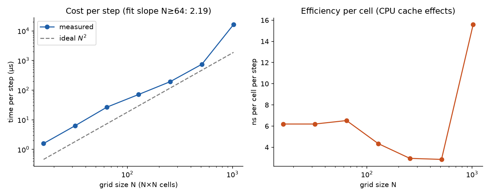
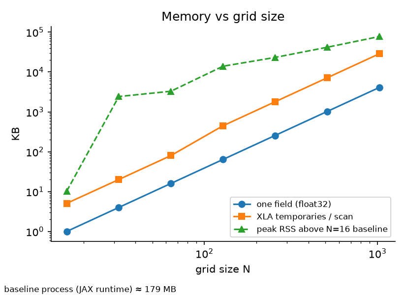
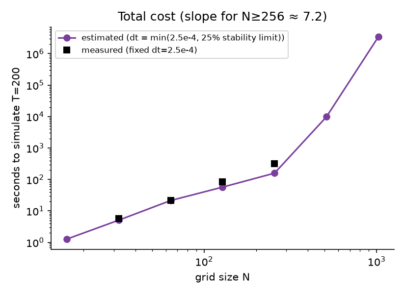
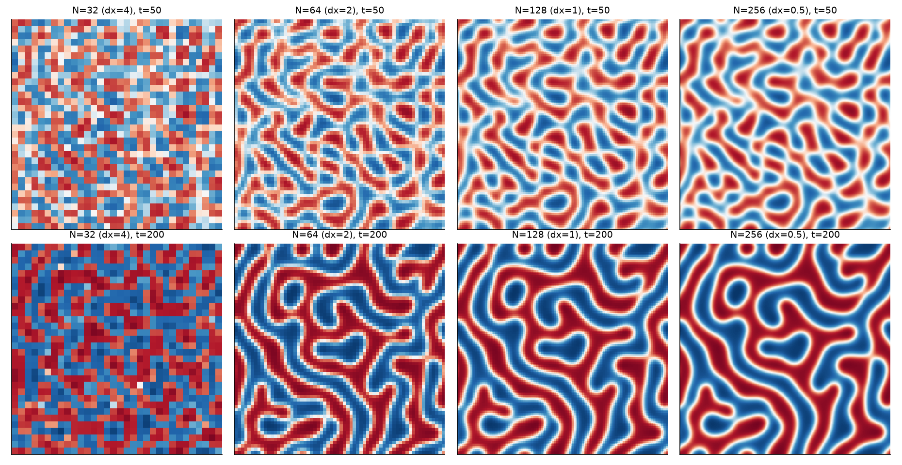
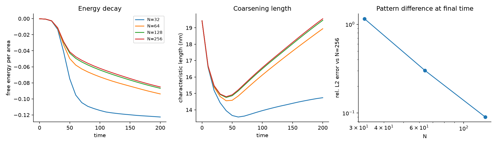

## 1. Setup

**Code:** `ajvetturini/phase-field-models` (JAX). **Model:** 2-D Cahn-Hilliard, Landau free energy (ε = 0.9), k = 1, interface scalar 2, M = 1, explicit Euler, float32, periodic boundaries, no autodiff. **Hardware:** CPU only (2 vCPU Xeon 2.1 GHz, 7 GB), JAX 0.11.2, Python 3.13.

**Consistent setup.** The physical domain is fixed at L = 128 nm, so refining the grid means dx = L/N (N = 32, 64, 128, 256). All runs start from the *same* smooth random field (modes |m| ≤ 8, mean 0.01), so differences come only from resolution. Every run uses dt = 2.5×10⁻⁴ for 800,000 steps (T = 200). That is 25% of the explicit-Euler stability limit at the finest grid, dt_max ≈ dx⁴/(32 κ M) with κ = 2.

**Measurements.** (i) *Cost per step* for N = 16 to 1024 (min of 3 repeats, JIT compile time excluded and reported separately). (ii) *Memory*: peak process RSS (each run in a fresh process), the XLA temporary-buffer size, and the raw field size. (iii) *Accuracy*: free energy per area, characteristic domain length (first moment of the structure factor), and relative L2 difference from the N=256 run (the reference is block-averaged down to each coarser grid).

## 2. Results

**Table 1. Cost per step** (fixed physical setup, measured). The last two columns *extrapolate* the total cost of reaching T = 200 using dt = min(2.5×10⁻⁴, 0.25·dt_max) and the measured µs/step. Only N ≤ 256 were actually run to T = 200.

| N | dx (nm) | µs/step | ns/cell/step | JIT compile (s) | field (KB) | XLA temp (KB) | peak RSS (MB) | dt used | est. time to T=200 |
|---|---|---|---|---|---|---|---|---|---|
| 16 | 8 | 1.7 | 6.7 | 0.15 | 1 | 5 | 247 | 2.5e-4 | 1.4 s |
| 32 | 4 | 6.8 | 6.7 | 0.18 | 4 | 20 | 249 | 2.5e-4 | 5.5 s |
| 64 | 2 | 27.6 | 6.7 | 0.16 | 16 | 80 | 249 | 2.5e-4 | 22 s |
| 128 | 1 | 85.6 | 5.2 | 0.22 | 64 | 448 | 253 | 2.5e-4 | 69 s |
| 256 | 0.5 | 281.2 | 4.3 | 0.33 | 256 | 1792 | 260 | 2.4e-4 | 3.8 min |
| 512 | 0.25 | 1223 | 4.7 | 0.41 | 1024 | 7168 | 284 | 1.5e-5 | ~4.5 h (extrap.) |
| 1024 | 0.125 | 5254 | 5.0 | 0.44 | 4096 | 28672 | 343 | 9.5e-7 | ~300 h (extrap.) |

**Table 2. The same simulation at four resolutions** (measured, dt = 2.5×10⁻⁴, T = 200).

| N | dx (nm) | runtime (s) | energy / area | energy error vs N=256 | domain length (nm) | rel. L2 error vs N=256 |
|---|---|---|---|---|---|---|
| 32 | 4 | 7.6 | -0.1225 | -44% | 14.7 | 1.16 |
| 64 | 2 | 24.4 | -0.0938 | -10.2% | 18.9 | 0.30 |
| 128 | 1 | 73.8 | -0.0868 | -2.0% | 19.5 | 0.09 |
| 256 | 0.5 | 264.4 | -0.0851 | reference | 19.6 | n/a |

{width=95%}

{width=60%}

{width=60%}

{width=100%}

{width=100%}

## 3. Discussion: cost vs. resolution

**Runtime per step scales as about N^1.9**, i.e. almost linearly in the number of cells (fit for N ≥ 64). Cost per cell stays at roughly 4 to 7 ns, a little lower at N ≥ 128 where fixed per-call overhead is amortised. Doubling N costs about 3.1 to 4.4 times more per step. Compilation is cheap (under 0.5 s) and independent of N.

**Memory is not the constraint here.** A field is 4N² bytes (256 KB at N=256) and XLA allocates about 7 field-sized temporaries for the update (the rolls in the two Laplacians and the chemical potential), so working memory is about 7 times the field. Process RSS is dominated by the roughly 250 MB JAX runtime up to N=512. Only at N=1024 does it grow visibly (343 MB). On a GPU, memory would matter at much larger 2-D or 3-D grids, where the same 7× factor applies.

**The real cost driver is the time step.** Explicit Euler for Cahn-Hilliard is limited by dt ∝ dx⁴. Once that limit binds (N ≥ 256 here), halving dx costs 4× more cells and 16× more steps, so the total cost grows as about N⁶ (fitted slope 6.1). The extrapolated times (about 4.5 h at N=512 and about 300 h at N=1024, *not run*) show why uniform fine grids with this integrator are impractical. A semi-implicit/spectral integrator (also in the package) or a GPU would be the natural remedy, though the README itself notes that the spectral scheme was slower per step.

**Resolution and pattern quality.** The interface in this model has a width parameter w = 2·√(k/ε) ≈ 2.1 nm (10 to 90% width about 4.6 nm). So:

- **N=32 (dx=4 nm)**: the interface is about one cell wide. The dynamics are wrong and the pattern is grid-scale noise (energy off by 44%).
- **N=64 (dx=2)**: about 2 cells across the interface. The labyrinth topology is right, but domains are too small (18.9 vs 19.6 nm) and energy is 10% off.
- **N=128 (dx=1)**: about 4 to 5 cells across the interface. Energy is within 2% and patterns agree visually (9% L2 difference). This is the best trade-off: 3.6× cheaper than N=256 for a 2% energy error.
- **N=256 (dx=0.5)**: the reference.

Energy error falls by about 5× per doubling of N (10.2% to 2.0%), consistent with a roughly second-order spatial discretisation. A rule of thumb from these runs: use at least about 4 cells across the interface.

**Time-step check.** Halving dt at N=64 (1.25×10⁻⁴, 1.6M steps) changed the final energy by 0.004% and the field by 0.15% (relative L2), so the errors in Table 2 are spatial, not temporal.

## 4. Limitations

- Single initial condition and seed, one model/integrator/precision (Landau, Cahn-Hilliard, explicit Euler, float32). Coarsening is sensitive to small perturbations, so pixel-level L2 differences should be read as indicative.
- N=256 is the reference, not a converged "truth" (no N=512 simulation was run). The error numbers are relative to it.
- CPU-only timings (2 vCPU). GPU behaviour, the spectral integrator, float64 and the Wertheim models were not tested. N=512 and 1024 were timed per step only; their total times are extrapolations.
- Peak RSS has a large constant JAX baseline; the XLA temporary size is a better indicator of how memory scales.

## 5. Reproduce

```
python run_all.py timing    # Table 1 (per-step cost, memory)
python run_all.py sim       # Table 2 (identical simulations, N=32..256)
python make_report.py       # tables (CSV/markdown) and plots
```
`bench.py` is the single-run worker. Set `PYTHONPATH` to the cloned repository.
